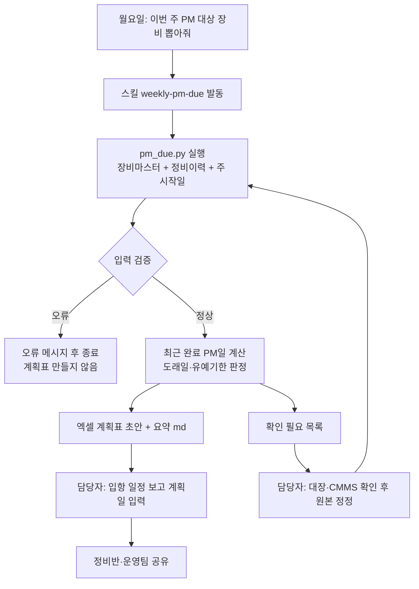

# PRD: 주간 PM 도래 장비 자동 추출기

> Product Requirements Document: **어떻게** 만들었는가. 다음 AI나 동료가 새 대화에서 이 문서만 읽고 이어서 작업할 수 있게 쓴다.
> 작성일 2026-11-19 · 버전 Phase 1 (구현·검증 완료, 실제 이력 적용 전)
> 함께 읽을 문서: `brd.md`(목적), `README.md`(실행법), `08p_팀스킬/팀_공통_전제.md` 1-1·3-1(장비 목록·주기 기준)

---

## 1. 목적
매주 월요일 담당자가 42대의 마지막 PM일과 주기를 눈으로 대조하던 "점검 도래 장비 찾기"를 엑셀 입력 → 스크립트 1회 실행으로 바꾼다. 결과는 계획일만 채우면 되는 **주간 PM 계획표 초안**이다.

## 2. 대상 사용자
| 사용자 | 환경 | 사용 방식 |
|---|---|---|
| 장비팀 하역장비 관리 담당 | 사무실 PC, 엑셀에 익숙, VS Code + Claude Code | 매주 월요일 "이번 주 PM 대상 장비 뽑아줘" 요청(스킬), 결과 엑셀 검토 후 계획일 입력 |
| 정비반·운영팀 (간접) | 엑셀·메일 | 담당자가 계획일을 채운 계획표를 받음 |

## 3. 핵심 기능과 요구사항
| ID | 기능 | 상세 | 상태 |
|---|---|---|---|
| F1 | 장비마스터 읽기 | 시트 `장비마스터`, 열 `호기·구분·타입·PM주기(일)·유예(일)`. 실제 42대 | 완료 |
| F2 | 정비이력 읽기 | 시트 `정비이력`(옵션으로 변경 가능). 필수 열 `정비일자·호기·정비유형·상태`. 날짜는 datetime 또는 `YYYY-MM-DD` 문자열 | 완료 |
| F3 | 최근 PM일 계산 | 정비유형 `PM` + 상태 `완료` 중 최댓값. BM·법정검사는 제외 | 완료 |
| F4 | 상태 판정 | 아래 4-1 규칙 | 완료 |
| F5 | 주간 계획표 초안 | 대상 = 주기 초과 + 유예 중 + 이번 주 도래. 정렬은 상태 우선순위 → 초과일수 내림차순 → 도래일 → 호기. 계획일·입항 일정 칸은 노란 빈칸 | 완료 |
| F6 | 확인 필요 분리 | 이력 없음 / PM 진행중(직전 완료 PM으로 판정하고 비고 표시) / 장비마스터에 없는 호기 / 주 시작일 이후 날짜 / 행 읽기 실패 | 완료 |
| F7 | 요약 md | 상태별 대수, 대상 표(비고 포함), 확인 필요 목록 | 완료 |
| F8 | 입력 검증 | `--week-start`가 월요일이 아니거나 형식 오류, 시트 없음 → 오류 메시지 후 종료 | 완료 |
| F9 | 스킬 | `.claude/skills/weekly-pm-due/SKILL.md`. 설명문에 사용 요청 예시, 하지 말 것(일정 배정·추측 금지) | 완료 |

### 3-1. 수용 기준
- [x] 장비 42대 전원이 `전체 현황`에 한 번씩 나온다
- [x] 독립 재계산과 상태가 100% 일치한다 (`verify.py`)
- [x] 경계값: 유예기한 당일 = 유예 중, 유예기한 다음 날 = 주기 초과, 주 시작·종료일 = 이번 주 도래
- [x] 계획표의 계획일 칸이 비어 있다 (도구가 일정을 배정하지 않음)
- [x] 의도한 오류 4종이 모두 `확인 필요`에 나오고, 판정에 쓰이지 않는다
- [x] 잘못된 인자는 결과를 만들지 않고 오류로 종료한다
- [ ] 실제 정비 이력으로 실행해 수작업 결과와 누락 0건 **(미검증)**

## 4. 판정 로직

### 4-1. 규칙 (`pm_due.classify`)
```
도래일   = 최근PM일 + PM주기
유예기한 = 도래일 + 유예(현재 7일, 가정)
주 종료일 = 주 시작일(월) + 6일

유예기한 < 주 시작일                   → 주기 초과   (초과일수 = 주 시작일 − 도래일)
도래일 < 주 시작일 ≤ 유예기한          → 도래(유예 중)
주 시작일 ≤ 도래일 ≤ 주 종료일         → 이번 주 도래
주 종료일 < 도래일 ≤ 주 종료일 + 7일   → 다음 주 도래
그 외                                   → 정상
완료 PM 없음                            → 이력 없음(확인 필요)
```

### 4-2. 주기 기준 (장비마스터에 저장, 팀 공통 전제 3-1)
| 구분 | 호기 | 주기 |
|---|---|---:|
| G/C | 181~190 | 45일 |
| T/C 엔진발전기 | 216, 217, 218, 219, 221, 228, 229, 277, 278 | 30일 |
| T/C 전기 | 215, 224~227, 271~276, 279, 422, 424~426, 428, 430~435 | 60일 |

## 5. 화면(출력물) 설계
엑셀 `출력/주간PM계획_YYYY-Www.xlsx`의 시트 구성:

| 순서 | 시트 | 내용 | 색 |
|---|---|---|---|
| 1 | 주간PM계획(초안) | 순위, 호기, 구분, 타입, 주기, 최근PM일, 도래일, 유예기한, 상태, 초과일수, **계획일(직접 입력)**, **입항 일정 확인**, 비고 | 상태 칸: 초과 진한 주황 / 유예 연한 주황 / 이번 주 노랑. 입력 칸: 연노랑 |
| 2 | 다음주 예고 | 다음 주 도래 장비 | – |
| 3 | 확인 필요 | 호기, 구분, 내용(행 번호 포함) | – |
| 4 | 전체 현황 | 42대 전체, 호기 순 | 상태별 색 |
| 5 | 판정 기준 | 스크립트 docstring 그대로 | – |

요약 `출력/주간PM요약_YYYY-Www.md`: 제목(대상 주) → 상태별 대수 → 이번 주 대상 표 → 확인 필요 → 주의 문구.

## 6. 사용자 흐름


## 7. 기술 사양
| 항목 | 내용 |
|---|---|
| 언어 | Python 3.12 (프로젝트 루트 `.venv`) |
| 라이브러리 | openpyxl (엑셀 읽기·쓰기). pandas 미사용 |
| 실행 | 로컬 CLI. 외부 네트워크·API 호출 없음 |
| AI 연동 | Claude Code 스킬(실행·보고 담당). 판정 자체는 결정적 코드로 처리해 AI가 추측할 여지가 없음 |

### 7-1. 파일·함수 구조
```
13_PM도래추출기/
├─ brd.md, prd.md, README.md
├─ make_inputs.py      # 입력 생성: make_master()(실제 42대), make_history()(가상 이력, 의도한 오류 4종)
├─ pm_due.py           # 본체
│   ├─ to_date()        날짜 변환 (datetime/date/문자열)
│   ├─ read_rows()      시트 → dict 목록, 시트 없으면 종료
│   ├─ load_master()    장비마스터 → {호기: 구분·타입·주기·유예}
│   ├─ classify()       상태 판정 (4-1 규칙)
│   ├─ analyze()        최근 PM 계산, 확인 필요 수집, 정렬
│   ├─ write_outputs()  엑셀 5시트 + 요약 md
│   └─ main()           인자: --master --history [--history-sheet] [--week-start] [--out]
├─ verify.py           # 독립 검산(원본 재계산 vs 산출물) + 경계값 8건
├─ 입력/장비마스터.xlsx, 입력/PM이력_가상.xlsx
└─ 출력/주간PM계획_2026-W47.xlsx, 출력/주간PM요약_2026-W47.md
../.claude/skills/weekly-pm-due/SKILL.md
```

### 7-2. 검증 결과 (2026-11-19, 가상 이력)
- `verify.py 2026-11-16`: **59/59 통과**. 결과는 이번 주 대상 9대(초과 3, 유예 2, 이번 주 4), 다음 주 5대, 확인 필요 4건
- `verify.py 2026-11-23`: 59/59 통과
- 잘못된 인자 3종(목요일 날짜, `2026/11/16`, 없는 시트): 오류로 종료
- **미검증**
  - 실제 이력 데이터
  - 엑셀에서 열었을 때의 서식
  - 새 대화에서 스킬 자동 발동

## 8. 한계
- 유예 7일은 가정값이다. 장비마스터 `유예(일)` 열에서 장비별로 바꿀 수 있다.
- 정비유형·상태 값이 `PM`·`완료`와 정확히 같아야 한다. 표기가 다르면 매핑 기능이 없어 인식하지 못한다.
- 가동시간(아워미터) 기준 PM은 지원하지 않는다.
- 이력 정정은 사람이 원본에서 해야 한다. 도구는 원본을 수정하지 않는다.

## 9. 구현 계획과 확장 포인트
| Phase | 내용 | 상태 |
|---|---|---|
| Phase 1 | 도래 판정 + 계획표 초안 + 확인 필요 + 스킬 + 검산 | **완료** |
| Phase 1.1 | 실제 이력 적용: 열 이름·정비유형 표기 매핑 옵션(`--map 정비유형:예방정비=PM`), 유예 기간 확정 | 예정 (BRD 8장 결정 후) |
| Phase 2 | 부품 준비 확인: PM 대상 장비의 필요 부품을 재고 목록과 대조(목요일 부품 점검 업무와 연결) | 구상 |
| Phase 2 | 입항 일정 엑셀을 함께 읽어 본선 작업과 겹치는 날을 표시 (배정은 여전히 사람이 함) | 구상 |
| Phase 3 | CMMS 내려받기 파일 직접 읽기, 정비 검토 서브에이전트(`equipment-maintenance-reviewer`)와 연계해 상태 미갱신 자동 점검 | 구상 |

## 10. 이어받는 AI에게
- 판정 규칙을 바꾸면 `pm_due.classify`와 `verify.py`의 재계산 로직, 경계값 케이스를 **함께** 수정하고 검산을 다시 돌린다.
- 장비 목록·주기는 코드가 아니라 `입력/장비마스터.xlsx`와 `팀_공통_전제.md`에서 바꾼다. `make_inputs.py`의 상수도 같이 맞춘다.
- 계획일 자동 배정, PM 연기 판단은 요구받아도 범위 밖이다(BRD 3-2). 사용자에게 먼저 확인한다.
